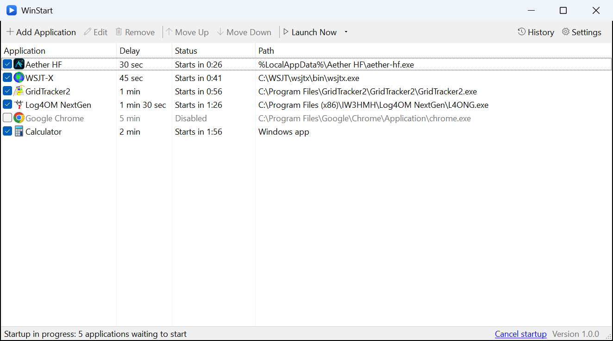
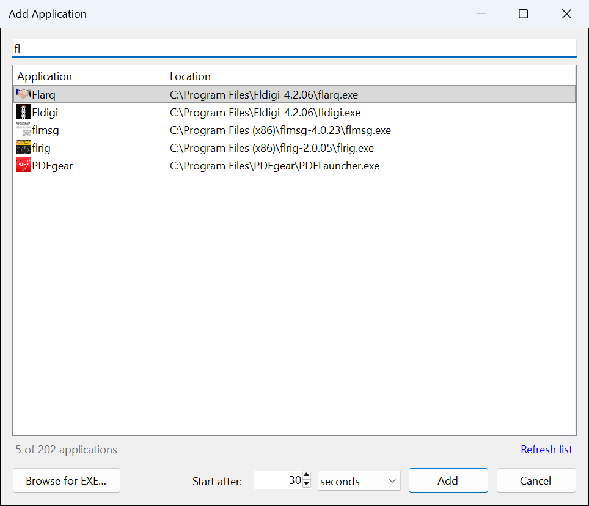
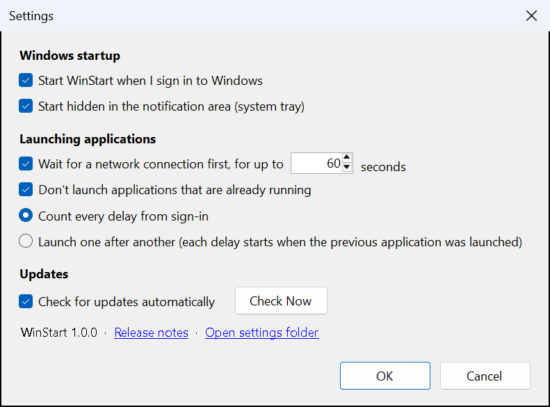
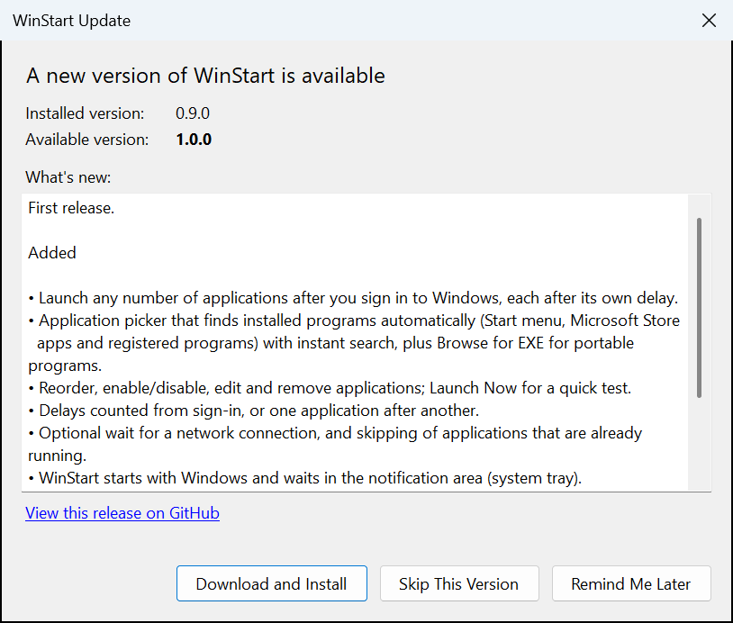

# WinStart

[](https://github.com/KK4ODA/WinStart/actions/workflows/ci.yml)
[](https://github.com/KK4ODA/WinStart/releases/latest)

WinStart launches the programs you choose after you sign in to Windows, **each after its own
delay**. Instead of everything piling up the moment the desktop appears, your logging software can
start after 30 seconds, your browser after a minute, and so on.

It is a small Windows utility: one 250 KB program, no administrator rights, no background
services, and it updates itself from this repository's releases when you tell it to.



## Install

1. Download **`WinStart-Setup-x.y.z.exe`** from the [latest release](https://github.com/KK4ODA/WinStart/releases/latest).
2. Run it. It installs for your user account only, so Windows does not ask for an administrator.
3. WinStart opens. Click **Add Application** and pick what should start after you sign in.

> **"Windows protected your PC"?** The installer is not code-signed yet, so SmartScreen may show
> this the first time. Click **More info**, then **Run anyway**. You can check the download
> against `SHA256SUMS.txt` from the same release:
> `Get-FileHash .\WinStart-Setup-x.y.z.exe` in PowerShell.

Requirements: Windows 10 (version 1903 or later) or Windows 11. Nothing else needs installing;
WinStart uses the .NET Framework 4.8 that is part of Windows.

To remove WinStart, use **Settings > Apps > Installed apps**. Your WinStart settings are left in
`%AppData%\WinStart` in case you reinstall; delete that folder to remove them too.

## Using WinStart

### Adding applications

**Add Application** lists what is installed on your PC: everything in the Start menu (including
Microsoft Store apps) plus programs registered with Windows. Type to search, pick one or more,
choose the delay, and click **Add**. For portable programs that are not installed anywhere, use
**Browse for EXE...**.



### The list

| Column | Meaning |
|---|---|
| Check box | Enabled. Unticked applications stay in the list but are not launched. |
| Application | Name and icon. Double-click (or press Enter) to edit. |
| Delay | How long after sign-in the application starts. |
| Status | *Ready*, a countdown such as *Starts in 0:25*, *Started 8:01 AM*, *Already running*, or why it failed. |
| Path | The program that is launched. |

Toolbar: **Add Application**, **Edit**, **Remove**, **Move Up**, **Move Down**, **Launch Now**,
**History**, **Settings**. The arrow next to **Launch Now** offers **Run Startup Sequence Now**,
which behaves exactly like signing in and is the easy way to test your setup. A running sequence
can be stopped with **Cancel startup** in the status bar.

**Edit** also lets you set command-line arguments and start an application minimized.

Closing the window sends WinStart to the notification area (system tray). Right-click its icon
and choose **Exit** to quit completely.

### What happens when you sign in

1. Windows starts WinStart (hidden in the tray by default).
2. WinStart waits until the desktop is ready, meaning the taskbar exists.
3. If enabled, it waits for a network connection (up to the time you set, then continues anyway).
4. Each enabled application is launched when its delay has passed. Applications that are already
   running are skipped.
5. Every result is written to the startup history (**History**).

### Settings



- **Start WinStart when I sign in to Windows** uses the standard per-user startup entry, the same
  one Task Manager shows under *Startup apps*.
- **Count every delay from sign-in** (default): a 30-second and a 2-minute application start 30
  seconds and 2 minutes after sign-in.
- **Launch one after another**: applications start in list order, and each delay begins when the
  previous application was launched.

## Updating

WinStart checks this repository's [releases](https://github.com/KK4ODA/WinStart/releases) about
once a day (switch this off in **Settings**) and whenever you click **Check Now**, or **Check for
Updates...** in the tray menu.

When a newer version exists it shows your version, the new version and the release notes, with
three choices: **Download and Install**, **Skip This Version**, or **Remind Me Later**. Nothing
is ever installed without your click.



**Download and Install** downloads the installer from the release, verifies it against the
release's SHA-256 checksum, closes WinStart, installs the new version and starts it again. Your
applications and settings are untouched: they live in `%AppData%\WinStart`, not in the program
folder. Running a newer installer by hand has the same effect.

## Files

Everything WinStart stores is in `%AppData%\WinStart` (**Settings > Open settings folder**):

| File | Contents |
|---|---|
| `config.json` | Your applications and settings. |
| `history.jsonl` | Startup history, one JSON object per line. |
| `winstart.log` | Diagnostic log (kept below about 1 MB). |

`config.json` is plain JSON and safe to edit while WinStart is not running:

```json
{
  "schemaVersion": 1,
  "settings": {
    "startMinimized": true,
    "waitForNetwork": false,
    "networkTimeoutSeconds": 60,
    "launchMode": "independent",
    "skipIfRunning": true,
    "autoCheckUpdates": true,
    "skippedVersion": "",
    "trayHintShown": true
  },
  "apps": [
    {
      "id": "0f8fad5bd9cb469fa16570867728950e",
      "name": "WSJT-X",
      "path": "C:\\WSJT\\wsjtx\\bin\\wsjtx.exe",
      "arguments": "",
      "delaySeconds": 30,
      "enabled": true,
      "startMinimized": false
    }
  ]
}
```

`launchMode` is `"independent"` or `"sequential"`. `path` may contain environment variables such
as `%LocalAppData%`; Store apps use `shell:AppsFolder\<app id>`. Missing values fall back to
their defaults, and a file that cannot be read is kept as `config.json.unreadable-<date>` rather
than overwritten.

Advanced: set the environment variable `WINSTART_DATA_DIR` to keep these files somewhere else
(for a portable copy or for development). Such a copy runs independently of the installed one and
does not register itself to start with Windows unless you enable that in Settings.

## Troubleshooting

- **Nothing started after sign-in.** Open **Settings** and make sure *Start WinStart when I sign
  in to Windows* is ticked; Task Manager's *Startup apps* can switch it off as well. Then look at
  **History**.
- **An application shows "File not found".** It was moved or uninstalled. Select it, click
  **Edit**, and choose the program again.
- **An application starts twice.** Remove it from other startup places (its own "start with
  Windows" option, or Task Manager > Startup apps) and let WinStart launch it.
- **"Already running", but it is not.** WinStart recognises a running application by its program
  file. Entries that share one (several scripts run by `cmd.exe` or `pythonw.exe`, for example)
  look alike; switch off *Don't launch applications that are already running* in **Settings**.
- **Something else.** **History > Open Log File** shows details. Please include the relevant
  lines when [reporting an issue](https://github.com/KK4ODA/WinStart/issues).

---

## Development

### Technology

| Choice | Why |
|---|---|
| C# and Windows Forms on **.NET Framework 4.8** | 4.8 is a component of Windows 10/11 and is serviced by Windows Update, so WinStart ships as a single ~250 KB executable with no runtime to bundle or keep patched. It starts instantly and idles at a few tens of MB. Full access to Windows APIs through P/Invoke and COM. |
| No NuGet runtime dependencies | Nothing to update, nothing to conflict. JSON uses what the framework provides, isolated in one file ([Json.cs](src/WinStart/Core/Json.cs)). |
| SDK-style project, built with the current .NET SDK | Modern C#, `dotnet build`/`dotnet test`, and the same commands locally and in CI. |
| Inno Setup installer, per user | No administrator rights; the installer doubles as the updater, so there is exactly one code path that replaces program files. |
| GitHub Releases for distribution | Free hosting, release notes, and a stable API for update checks. |

The trade-off considered was .NET 10 (self-contained): newer runtime, but a ~50 MB download for
every install and update, more memory, and a new release needed for each runtime security fix.

### Layout

```
src/WinStart/            the application
  Core/                  settings, startup sequence, launching, history, logging
  Discovery/             finding installed applications and their icons
  Update/                GitHub release check, download, checksum verification
  UI/                    windows and dialogs (hand-written Windows Forms, no designer files)
  Native/                P/Invoke declarations
tests/WinStart.Tests/    unit tests (xUnit)
installer/WinStart.iss   Inno Setup script
build/build.ps1          build + test + package; used locally and by CI
build/release-notes.ps1  extracts one version's notes from CHANGELOG.md
build/make-icon.ps1      regenerates the application icon
.github/workflows/       ci.yml (every push/PR) and release.yml (version tags)
```

### Building

Prerequisites, both installable with winget:

```powershell
winget install Microsoft.DotNet.SDK.10
winget install JRSoftware.InnoSetup
```

Then:

```powershell
dotnet build                 # compile
dotnet test                  # run the unit tests
.\build\build.ps1            # test, build and package into .\artifacts
.\build\build.ps1 -SkipInstaller   # without Inno Setup
```

`artifacts\` then contains `app\WinStart.exe`, `WinStart-Setup-<version>.exe` and `SHA256SUMS.txt`.

While developing, run your build with its own data folder so it does not interfere with an
installed WinStart:

```powershell
$env:WINSTART_DATA_DIR = "$env:TEMP\WinStart-dev"
dotnet run --project src\WinStart
```

Command-line switches: `--startup` (run the startup sequence; this is what the Windows startup
entry passes), `--quit` (ask the running instance to exit; used by the installer) and `--updated`
(used by the installer after an update).

### Versioning and releases

WinStart follows [Semantic Versioning](https://semver.org). The version lives in exactly one
place, `<Version>` in [Directory.Build.props](Directory.Build.props); the program, the installer
and the release tag all derive from it.

To publish a release:

1. Set `<Version>` in `Directory.Build.props`, for example `1.1.0`.
2. Move the notes in [CHANGELOG.md](CHANGELOG.md) from *Unreleased* to a new `## [1.1.0] - <date>`
   section. Write them for users: this text becomes the release description and the "What's new"
   in the update dialog.
3. Commit, then tag that commit and push:

   ```powershell
   git tag v1.1.0
   git push origin main v1.1.0
   ```

The [release workflow](.github/workflows/release.yml) then checks that the tag matches the
version, runs the tests, builds the installer, writes `SHA256SUMS.txt` and publishes the GitHub
release. Installed copies of WinStart will offer the update within a day.

Rules worth knowing:

- The tag must be `v` + the version, or the workflow stops before building anything.
- A version without a `CHANGELOG.md` section is refused, so releases always have notes.
- Pre-release versions such as `1.2.0-beta.1` are published as GitHub pre-releases and are **not**
  offered by the updater, which only looks at the latest stable release.
- The updater expects the assets `WinStart-Setup-<version>.exe` and `SHA256SUMS.txt`. Keep those
  names.
- Never change `AppId` in `installer/WinStart.iss`; it is what makes a new installer an upgrade.

### Code signing

Releases are currently unsigned. To sign them later, add two steps where `build/build.ps1` marks
"Code signing hook": sign `WinStart.exe` before the installer is compiled, and sign the installer
before its checksum is taken (for example with `signtool` and a certificate, Azure Trusted
Signing, or SignPath). Keep certificates and passwords in GitHub Actions secrets; `.gitignore`
already blocks common certificate file types from being committed. No change to the updater is
needed: it verifies downloads by SHA-256 either way.

## License

WinStart is released under the [MIT License](LICENSE).
